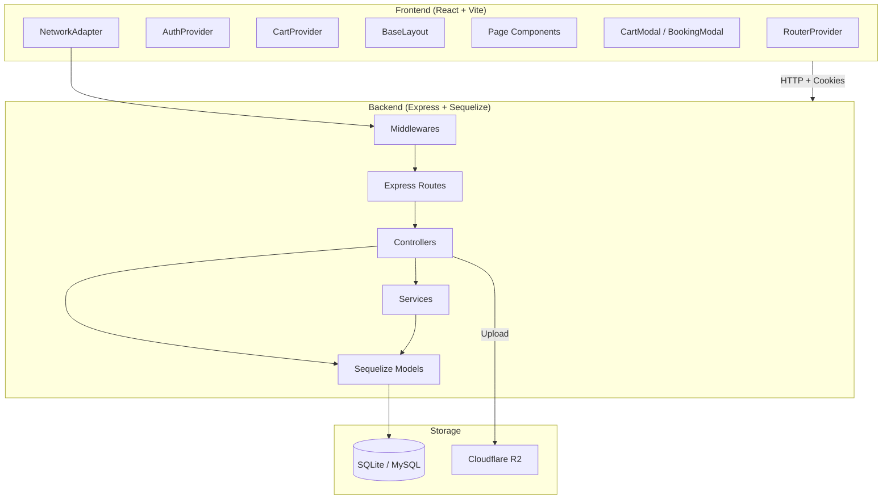
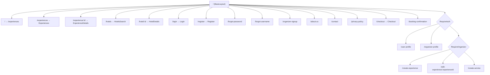
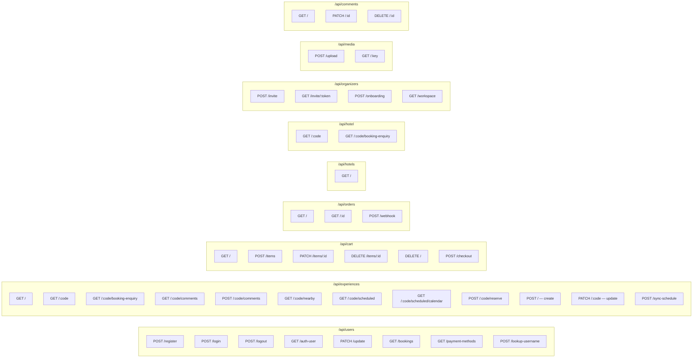
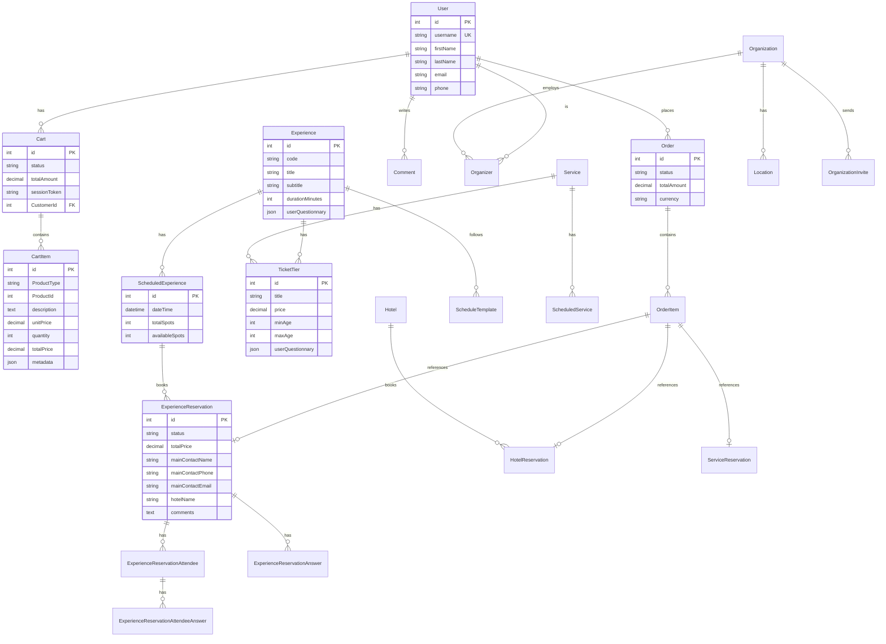
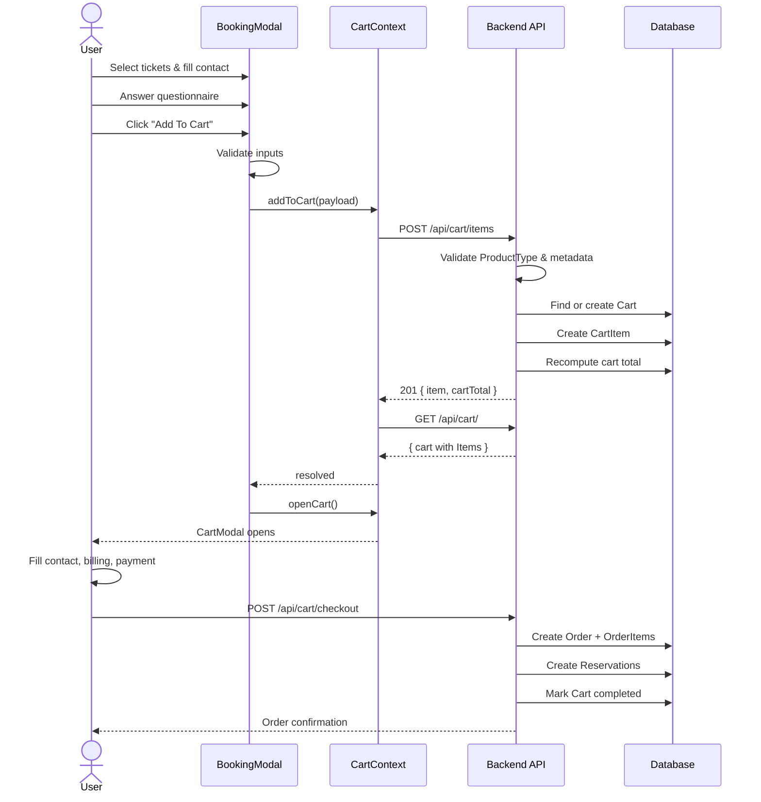
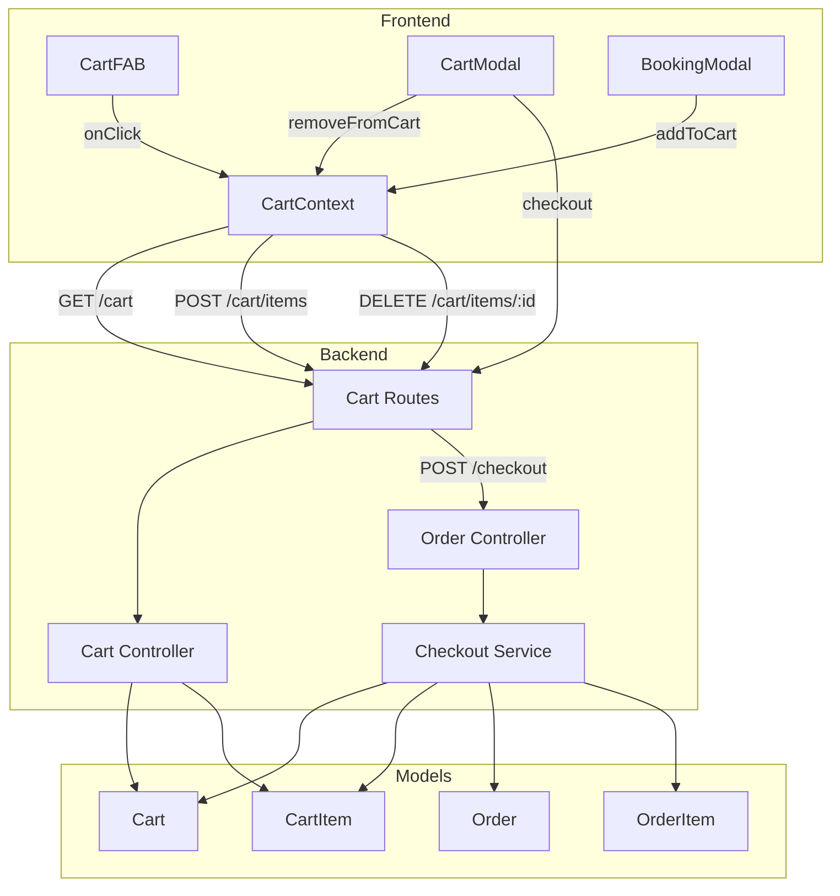
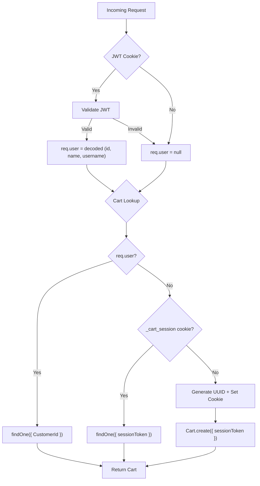
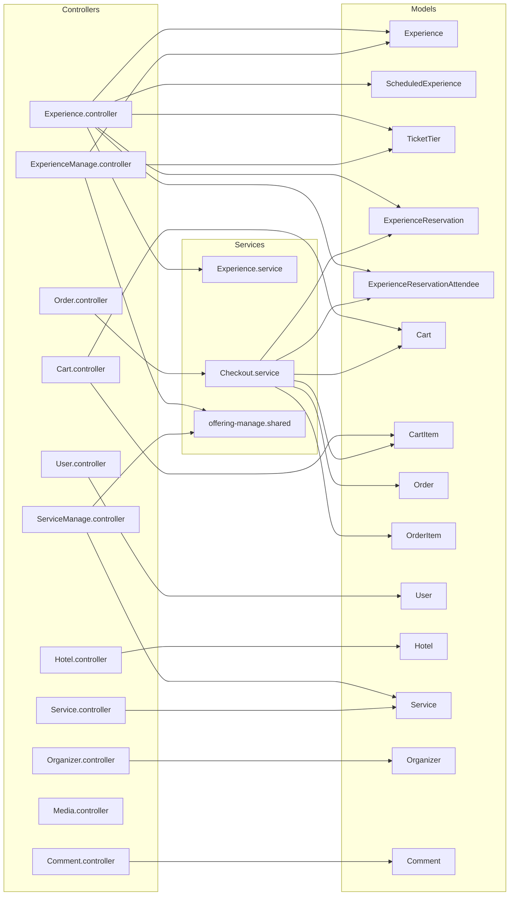
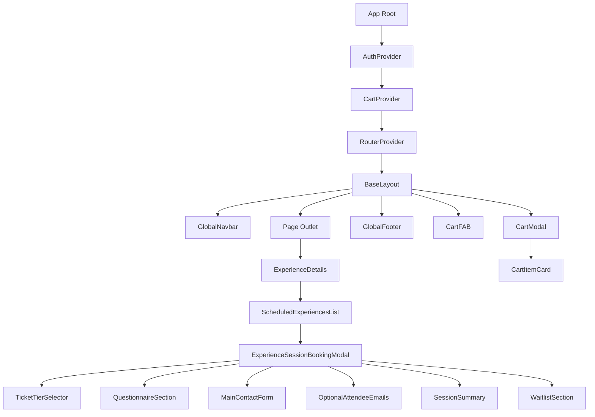

# Architecture Diagrams

All diagrams use [Mermaid](https://mermaid.js.org/) syntax.

---

## 1. High-Level System Architecture

---

## 2. Frontend Route Tree

## 2.1 Experience Gallery Composition

- `ExperienceDetails` composes an organizer-first gallery from organizer images or thumbnail fallback plus review images already included on loaded experience comments.
- `ImageGalleryModal` remains generic through an optional `renderSidebar(imageData)` prop so feature-specific review context stays outside the shared gallery implementation.
- Mixed galleries reuse the same thumbnail, lightbox, keyboard, and click navigation while separating modal thumbnails into "Experience Photos" and "Guest Photos" sections.

## 2.2 Organizer Workspace Tabs

- `OrganizerProfile` now uses the shared `Tabs` and `TabPanel` components for its primary workspace navigation, including separate `Organization` and `Experiences` tabs.
- `OrgMembersPanel` handles organization details, members, and pending invites against the organizer workspace payload.
- `OrgExperiencesPanel` handles searchable experience cards, inline schedule management actions, and destructive experience deletion backed by managed experience routes. The "Edit" button navigates to `/edit-experience/:experienceId`.

## 2.3 Experience Editing (Create/Edit Dual Mode)

- `CreateExperience` accepts `mode` (`'create'` | `'edit'`) and `experienceData` props. In edit mode it pre-populates all form steps, submits via PATCH, and detects schedule changes to display a sync-required alert.
- `EditExperience` is a route wrapper at `/edit-experience/:experienceId` that fetches the experience via `GET /api/experiences/manage/:id` and renders `CreateExperience` in edit mode.
- Backend `getExperienceForEdit` returns the full experience with `ScheduleTemplates`, `PickedOccurrences`, `TicketTiers`, `Organizers`, and `Location` associations.

---

## 3. Backend API Route Map

---

## 4. Data Model ERD (Core Entities)

---

## 5. Experience Booking Flow (Sequence)

---

## 6. Cart System Architecture

---

## 7. Authentication & Guest Cart Flow

---

## 8. Controller → Service → Model Dependencies

---

## 9. Frontend Component Hierarchy (Booking Flow)

